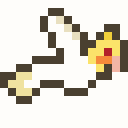
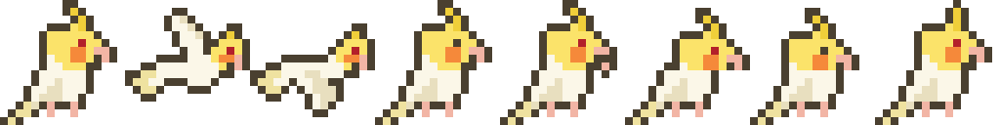

# parrot.js 🦜

A tiny pixel-art **lutino cockatiel** that flies after your cursor, inspired by [oneko.js](https://github.com/adryd325/oneko.js).

<p align="center"></p>

- Flies toward your mouse with flapping wings, turning left/right
- Raises its crest when startled ✨
- When idle it dances, blinks, sleeps (`z Z`) and talks:
  `السلام عليكم` · `امواححح` · `🎶` · `Peace be upon you` · `Mwahhh`
- **Zero assets:** the bird is drawn on a `<canvas>` from code. No images, no network, no `eval`, so it also works on strict-CSP sites like GitHub

<p align="center"></p>

## Usage

### On your site
```html
<script src="https://cdn.jsdelivr.net/gh/mPhpMaster/parrot.js@v1.0.0/parrot.js"></script>
```

### On any page (DevTools console)
Open the console (F12), paste the full contents of [`parrot.js`](parrot.js), and press Enter.

### Remove it
```js
document.getElementById("parrot-js").remove();
```

## Customize

Edit the constants at the top of `parrot.js`:

| Constant   | What it does                       |
|------------|------------------------------------|
| `PHRASES`  | Things the parrot says             |
| `SPEED`    | Flying speed (px per frame)        |
| `FRAME_MS` | Animation frame interval           |

### Editing the sprites
The sprites live in `tools/sprites.py` as 16×16 text grids, with one letter per palette color. After editing them, rebuild:

```bash
python3 tools/build.py   # regenerates parrot.js from tools/template.js
```

## Credits
Idea and movement logic inspired by [adryd325/oneko.js](https://github.com/adryd325/oneko.js). The cockatiel artwork is original.

## License
MIT
